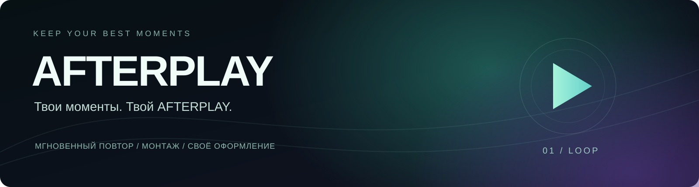
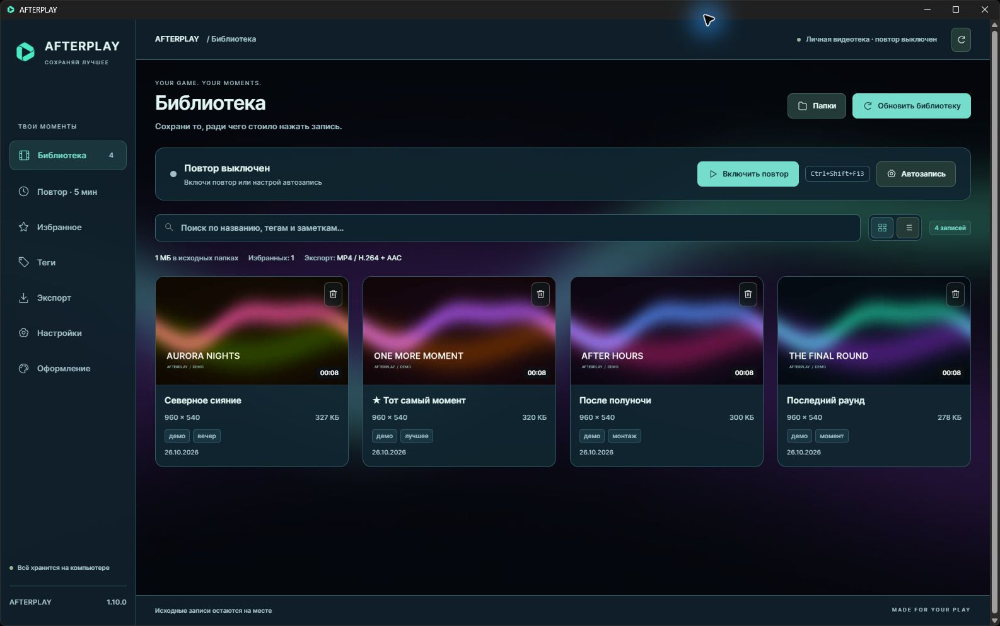
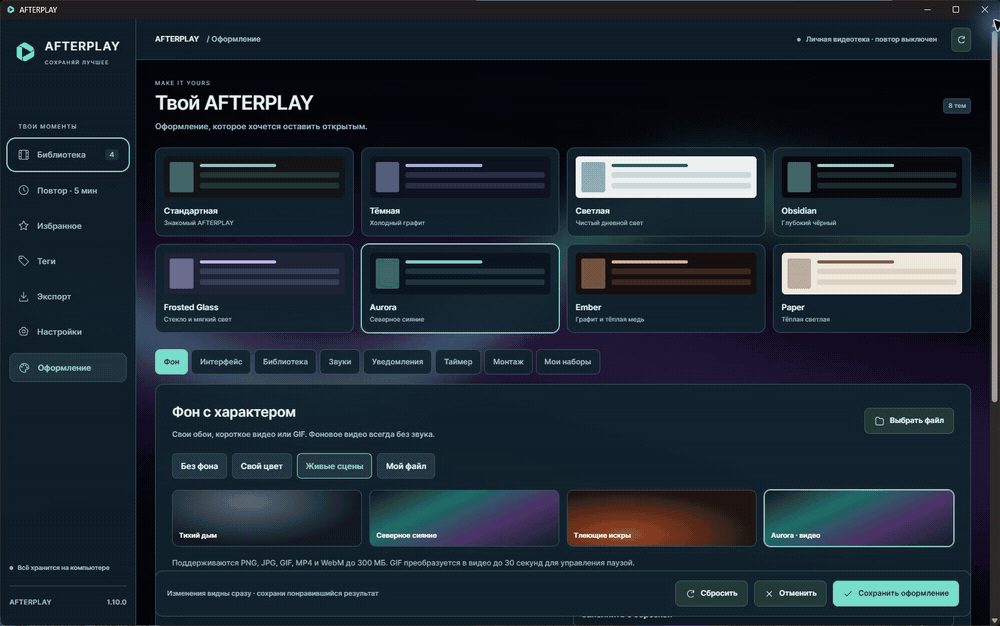
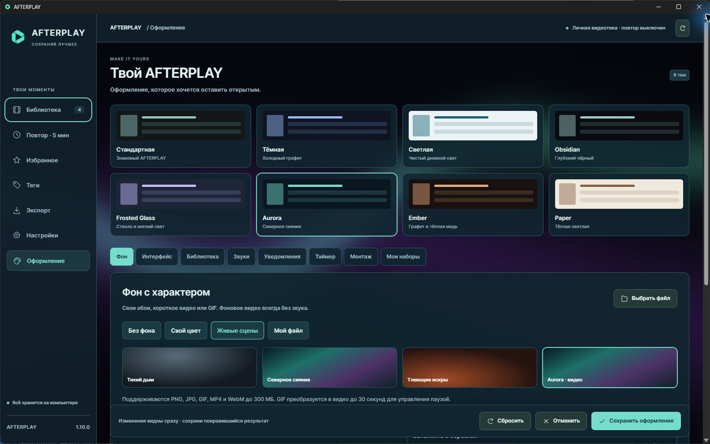
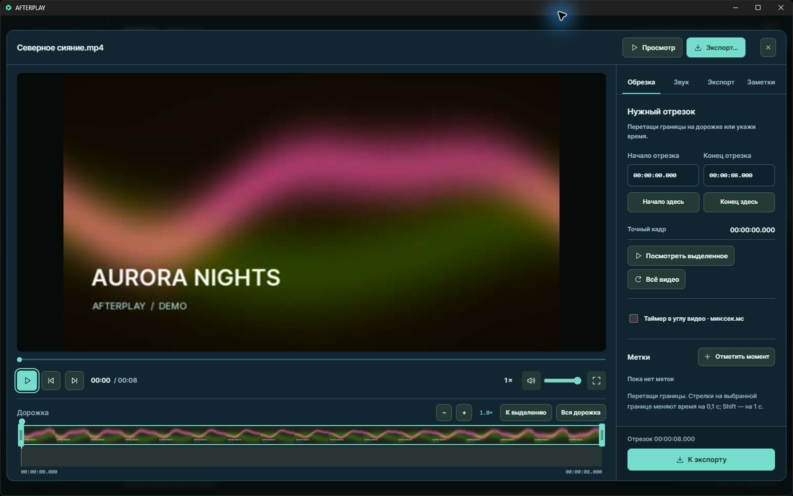

<p align="center"></p>

<p align="center">
  <a href="https://github.com/Rom4nIlyin/afterplay/releases/latest"></a>
  <a href="https://github.com/Rom4nIlyin/afterplay/actions/workflows/release.yml"></a>
  
  
  <a href="LICENSE"></a>
</p>

<p align="center"><b>Сохрани момент, который уже случился.</b><br>Мгновенный повтор, личная видеотека и монтаж для Windows — в одном portable-приложении.</p>

<p align="center"><a href="https://github.com/Rom4nIlyin/afterplay/releases/latest"><b>Скачать AFTERPLAY для Windows</b></a> · <a href="#быстрый-старт">Быстрый старт</a> · <a href="docs/CUSTOMIZATION.md">Оформление</a> · <a href="docs/STUDIO.md">Монтаж</a> · <a href="#english">English</a></p>



## Играй. Отмечай. Сохраняй.

Нажми **«Включить запись»**, чтобы начать, и **«Отключить запись»**, чтобы сохранить всё видео с начала сессии. Можно записывать час и дольше, пока хватает места на диске. **«Включить повтор»** отдельно запускает буфер последних **1–30 минут**. Оба режима могут работать одновременно: сохранение повтора не прерывает обычную запись. Дальше можно выбрать точный отрезок, настроить звук и экспортировать клип.

| Момент | Что умеет AFTERPLAY |
| :--- | :--- |
| **Запись** | Экран или окно, H.264, NVIDIA NVENC при наличии поддержки и CPU-путь, профили и необязательный автозапуск по приложению. |
| **Звук** | Устройство, выбранный процесс, исключение приложения, отдельные игра / чат и необязательная дорожка микрофона. |
| **Видеотека** | Поиск, теги, избранное, заметки, обложка из кадра и живые превью по наведению. |
| **Монтаж** | Общий таймлайн до 50 фрагментов: нарезка, порядок, свободное размещение, история и экспорт MP4 / GIF. |
| **Нажатия** | Необязательная запись клавиатуры и мыши без оверлея в игре; включаемый слой в монтаже и экспорте. |
| **Быстрые клипы** | Три дополнительные клавиши с собственной длительностью от 5 секунд до 30 минут. |
| **Твой стиль** | Onyx Cinema с пятью палитрами и иллюстрациями; классические темы, фоны, звуки и переносимые наборы оформления. |

При первом открытии короткое обучение показывает вкладки и основные настройки. Его можно пропустить или повторить через **Настройки → Пройти обучение**. Для новой установки включены автозапуск с Windows в трее и закрытие крестиком в трей; кнопка «Свернуть» оставляет окно на панели задач. Существующие настройки сохраняются.

## Onyx Cinema

Верхняя панель и тонкие полосы прокрутки следуют выбранной палитре. В редакторе перетаскиваемый разделитель регулирует высоту просмотра и дорожки; положение сохраняется.

Новый интерфейс: крупное превью, сведения о записи, пять палитр, свои цвета и четыре иллюстрации бокового меню. Выбранный профиль видно справа вверху. **Ctrl+K** открывает команды, **Ctrl+Z / Ctrl+Shift+Z** — историю обрезки, **I / O** — её границы. Экспорт MP4 или GIF можно отменить в панели прогресса. Классический интерфейс остаётся доступен в «Оформлении».

## Классическое оформление

**Obsidian · Frosted Glass · Aurora · Ember · Mist · Paper** — шесть заметно разных тем без близких дублей.
Меняй цвета, масштаб, карточки, расположение разделов, таймер и рабочее пространство. Сохраняй сочетания в наборы, переноси их вместе со своими ресурсами и удаляй ненужные с подтверждением.



*Короткая анимация смены оформления в приложении. Скриншоты ниже можно открыть в полном размере.*

<details>
<summary><b>Посмотреть экран оформления</b></summary>



</details>

Свой PNG, JPG, GIF, MP4 или WebM можно сделать фоном. Видео остаётся без звука; анимация может останавливаться при записи и экспорте и автоматически останавливается при скрытии окна. Сигналы метки, сохранения и ошибки настраиваются отдельно. [Все настройки оформления →](docs/CUSTOMIZATION.md)

## От большого повтора к нужному клипу

Открой запись или выбери несколько карточек кнопкой **+**, затем нажми **Монтаж** / **Собрать подборку**. Добавляй несколько нарезок одного видео, меняй порядок перетаскиванием, обрезай края, разрезай и размещай фрагменты на общей дорожке. Колесо прокручивает дорожку, Ctrl + колесо меняет масштаб; верхняя полоса быстро перематывает весь проект. Черновик сохраняется автоматически. Выбери звук, таймер и отображение нажатий для каждого фрагмента, затем экспортируй монтаж. Исходные записи остаются на месте.

**F** переключает полный экран, **пробел** и клик по видео — воспроизведение и паузу. Полноэкранные кнопки, перемотка и курсор скрываются через 1,5 секунды бездействия; движение мыши возвращает управление.



**Микрофон — по желанию.** Он включается в параметрах профиля, сохраняется отдельной дорожкой и может быть исключён из прослушивания или экспорта. Опция **«Чистый и ровный голос»** подавляет фоновый шум нейросетью RNNoise, выравнивает громкость речи и ограничивает пики. Обработка работает локально и применяется к новым записям; её можно отключить для каждого профиля. [Руководство по записи и монтажу →](docs/STUDIO.md)

## Быстрый старт

1. Скачай **`AFTERPLAY-1.14.2-Portable-Win64.zip`** со [страницы релиза](https://github.com/Rom4nIlyin/afterplay/releases/latest) и распакуй архив целиком.
2. Запусти **`AFTERPLAY.exe`**. Python и FFmpeg входят в комплект; при необходимости программа предложит установить WebView2.
3. На странице **Запись и повтор** выбери профиль, источник и звук. Изменения профиля сохрани зелёной кнопкой.
4. Включи обычную запись, повтор или оба режима. Прежняя горячая клавиша сохраняет последние X минут; обычная запись сохраняется целиком при отключении. Для неё можно назначить отдельное сочетание.

**Язык:** Настройки → Язык интерфейса → Русский / English. Выбор сохраняется после перезапуска.

На странице записи карточка **«Примерный размер файла»** пересчитывается сразу при изменении параметров. Для CBR/VBR используются длительность и битрейт видео/аудиодорожек; для CQ/CRF — диапазон с учётом разрешения, FPS, качества, кодировщика и пресета. [Как считается оценка →](docs/FILE-SIZE-ESTIMATE.md)

Кнопка **GitHub** рядом с обновлением открывает репозиторий AFTERPLAY в браузере. В настройках справа от неё находится поле со ссылкой на репозиторий и значком копирования внутри поля.

Справа снизу на каждой карточке видео есть значок корзины. Перед удалением можно выбрать **«В корзину»** или **«Удалить навсегда»**: второй вариант удаляет исходный видеофайл с компьютера, минуя корзину. Карточки настроек занимают высоту по содержимому и заполняют свободные места в двух колонках.

При сохранении клипа, GIF или монтажа используется введённое название без даты и случайных символов. При совпадении имени создаётся файл **«Название (2)»**, сохраняя существующий файл.

### Обновление

Используй проверку обновлений в настройках. Для ручного обновления полностью выйди из AFTERPLAY и запусти из **новой распакованной папки**:

```powershell
powershell.exe -NoProfile -ExecutionPolicy Bypass -File .\app\Update-Existing.ps1 -Target "C:\AFTERPLAY Portable"
```

Обновлятор создаёт резервную копию и сохраняет текущие настройки, наборы, горячие клавиши и библиотеку. Если программа находится в другой папке, укажи её через `-Target`.

### Требования и данные

Windows x64 с установленным WebView2. Запись звука отдельного процесса требует **Windows 11 или build 20348+**. GPU-кодирование зависит от видеокарты и драйвера; доступен CPU-путь. Микрофон и автозапись включаются отдельно.

Настройки и библиотека находятся рядом с приложением в `data`. Видео сохраняются в выбранной тобой папке. Для записи и редактирования учётная запись не нужна. Проверка обновлений обращается к GitHub.

<details>
<summary><b>Что лежит в portable-папке</b></summary>

```text
AFTERPLAY Portable/
├── AFTERPLAY.exe     запуск
├── README.md         краткая инструкция
├── app/              интерфейс, компоненты, Python и FFmpeg
├── docs/             руководства и лицензии
├── data/             создаётся при запуске: твои настройки и библиотека
└── backups/          создаётся при обновлении
```

Не копируй новый архив поверх работающей программы. [Подробнее об установке и обновлении →](docs/PORTABLE.md)

</details>

## Документация и разработка

| | |
| :--- | :--- |
| [Оформление и наборы](docs/CUSTOMIZATION.md) | Темы, фоны, звуки, превью, уведомления и язык. |
| [Запись и монтаж](docs/STUDIO.md) | Профили, звук, метки, точные кадры и экспорт. |
| [Сборка из исходников](docs/BUILD.md) | Windows, Python 3.13 x64 и закреплённые зависимости. |
| [Проверки](docs/VERIFICATION.md) | Автоматические и нативные проверки, ограничения результатов. |
| [История изменений](CHANGELOG.md) | Возможности и исправления по версиям. |
| [Сообщить о проблеме](https://github.com/Rom4nIlyin/afterplay/issues/new/choose) | Укажи версию, источник захвата и шаги воспроизведения. |

Исходники приложения распространяются по [MIT](LICENSE). Лицензии включённых компонентов перечислены в [THIRD-PARTY.md](THIRD-PARTY.md), политика подписи — в [CODE-SIGNING.md](docs/CODE-SIGNING.md).

Скриншоты показывают настоящий интерфейс 1.10.0 с специально созданными демонстрационными записями. Личные видео и настройки в репозиторий и portable-архив не включаются.

## English

**AFTERPLAY is a portable video recorder, instant replay buffer, video library and clip editor for Windows.** Record a complete session or keep the last 1–30 minutes; both modes can run together. Your replay hotkey saves the last X minutes without stopping manual recording. Build a montage with up to 50 segments: split, trim, reorder, duplicate, place freely, undo and export MP4 or GIF. Three optional hotkeys save clips of independent lengths. Optional keyboard and mouse recording stays invisible during gameplay; show or hide the input layer when editing or exporting. F toggles fullscreen; Space and a click on the video toggle playback. Fullscreen controls hide after 1.5 seconds of inactivity. Customize six distinct themes, image/GIF/video backgrounds, reusable appearance presets, sound cues and notifications. Optional microphone audio is saved as a separate track.

[Download for Windows](https://github.com/Rom4nIlyin/afterplay/releases/latest) → extract the entire archive → run **AFTERPLAY.exe**. Switch to English in **Settings → Interface language**. User recordings and settings stay on your computer; an account is not required for capture or editing.
