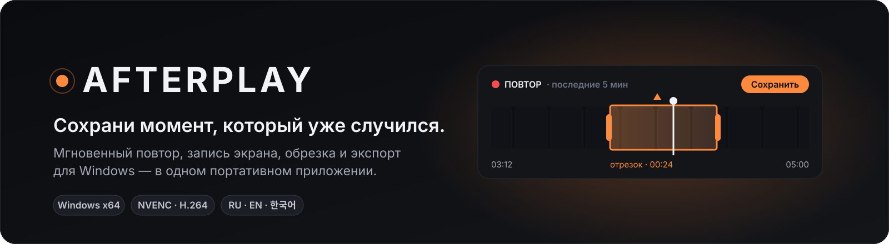

<p align="center"></p>

<p align="center">
  <a href="https://github.com/Rom4nIlyin/afterplay/releases/latest"></a>
  <a href="https://github.com/Rom4nIlyin/afterplay/actions/workflows/release.yml"></a>
  
  
  <a href="LICENSE"></a>
</p>

<p align="center">
  <a href="https://github.com/Rom4nIlyin/afterplay/releases/latest"><b>⬇ Скачать для Windows</b></a>
  &nbsp;·&nbsp; <a href="#как-это-работает">Как это работает</a>
  &nbsp;·&nbsp; <a href="#экспорт">Экспорт</a>
  &nbsp;·&nbsp; <a href="docs/USER-GUIDE.md">Руководство</a>
  &nbsp;·&nbsp; <a href="#english">English</a>
  &nbsp;·&nbsp; <a href="#한국어">한국어</a>
</p>

---

**AFTERPLAY** держит в памяти последние минуты игры. Случилось что-то стоящее — нажимаешь клавишу, и момент уже сохранён. Дальше его можно посмотреть, обрезать мышкой и выгрузить под Discord, TikTok, YouTube или в GIF. Всё работает на твоём компьютере: без аккаунтов, облака и рекламы.

## Возможности

<table>
<tr>
<td width="50%" valign="top">

### ⏺ Запись
- **Мгновенный повтор** — буфер последних 1–30 минут, сохранение по клавише.
- **Обычная запись** — от старта до остановки, хоть час и дольше.
- **Быстрые клипы** — последние 30 секунд или 2 минуты одной клавишей.
- Экран целиком или одно окно, H.264 через **NVIDIA NVENC** или процессор.
- **Профили игр** включают повтор сами, когда запускается игра.

</td>
<td width="50%" valign="top">

### 🔊 Звук
- Весь звук компьютера, только выбранная игра или всё, кроме неё.
- **Отдельные дорожки**: общий звук, игра, Discord / чат, микрофон.
- Шумоподавление микрофона — локально, без интернета.
- При просмотре и экспорте дорожки сочетаются как угодно, громкость каждой — до 150 %.

</td>
</tr>
<tr>
<td valign="top">

### 🎞 Библиотека и просмотр
- Записи сгруппированы по дням, есть поиск, избранное и метки моментов.
- Просмотр на всё окно: превью кадра при перемотке, скорость 0,1–5×.
- **← →** — по кадру, **Shift + ← →** — на 5 секунд. GIF тоже листается по кадрам.
- Можно подключить свои папки с видео: файлы остаются на месте.

</td>
<td valign="top">

### ✂ Обрезка и экспорт
- Края отрезка тянутся мышкой, таймер на видео — по галочке.
- Готовые варианты: Discord, Nitro, TikTok / Shorts, YouTube, GIF.
- У каждого варианта свой переключатель качества с подсказкой, что он даёт.
- «Копировать файл» — и клип сразу вставляется в Discord.

</td>
</tr>
</table>

## Как это работает

1. **Включи повтор** кнопкой в шапке или настрой профиль игры, чтобы он включался сам.
2. **Играй.** AFTERPLAY тихо держит в буфере последние минуты.
3. **Нажми `Ctrl` + `Alt` + `F10`**, когда случилось что-то стоящее. Момент сохранён.
4. **Обрежь и выгрузи**: открой запись, выдели отрезок и выбери, куда экспортировать.

| Действие | Клавиши по умолчанию |
| :--- | :--- |
| Сохранить повтор | `Ctrl` + `Alt` + `F10` |
| Быстрый клип: 30 секунд / 2 минуты | `Ctrl` + `Alt` + `F6` / `F7` |
| Показать или спрятать окно | `Ctrl` + `Alt` + `F8` |
| Начать / остановить запись, поставить метку | назначаются в настройках |

## Экспорт

| Вариант | Качество на выбор | Для чего |
| :--- | :--- | :--- |
| **Discord · до 10 МБ** | Чётче · 30 fps / Плавнее · 60 fps | Без Nitro. Два прохода сжатия, разрешение подбирается по длине: короткий клип — 1080p, длинный — меньше, но без «квадратов». |
| **Discord Nitro · до 500 МБ** | Стандарт / Высокое / Исходник | Исходное разрешение и fps. |
| **TikTok / Shorts · 9:16** | 720p / 1080p / 1080p макс. | Вертикальное видео с обрезкой по центру. |
| **YouTube** | Высокое / Исходник | «Исходник» копирует видео без перекодирования: качество как в записи, экспорт за секунды. |
| **GIF** | Лёгкий / Хорошее / Высокое | 2–15 секунд, до 1080 px и 30 fps, своя палитра на каждый кадр. |

## Установка

1. Скачай `AFTERPLAY-…-Portable-Win64.zip` со [страницы выпуска](https://github.com/Rom4nIlyin/afterplay/releases/latest) и сверь его с файлом `.sha256`.
2. Распакуй архив целиком в любую папку, например `C:\AFTERPLAY Portable`.
3. Запусти **`AFTERPLAY.exe`**. Python, FFmpeg и установщик WebView2 уже внутри.

Обновления приходят через **Настройки → Обновления**: записи, профили и настройки сохраняются, старые файлы программы уходят в резервную копию.

**Нужно:** Windows 10 или 11 x64. Звук отдельной игры — Windows 11 (или сборка 20348+). NVENC — видеокарта NVIDIA; без неё запись идёт через процессор.

<details>
<summary><b>Где что хранится</b></summary>

| Папка | Что внутри |
| :--- | :--- |
| `AFTERPLAY.exe` | Запуск программы |
| `app` | Программа: Python, интерфейс, FFmpeg, обновлятор |
| `data` | Настройки, библиотека, журналы; появляется при первом запуске |
| `docs` | Руководство, список изменений, лицензии |
| `backups` | Прошлые файлы программы; появляется при обновлении |

Записи лежат в папке, которую ты выберешь в настройках. Удаление программы их не трогает.
</details>

## Для разработчиков

```text
src/        программа — то же, что попадает в папку app/ сборки: Python, интерфейс (src/ui), модели
native/     C#-лаунчер, обновлятор и помощники для звука и уведомлений
scripts/    сборка portable-архива, словари переводов, переупаковка после подписи
tests/      тесты Python и JavaScript
docs/       руководство, сборка, проверки, лицензии, архив старых заметок
```

```powershell
python -m unittest discover -s tests -t .     # тесты Python
python scripts/build_translations.py --check  # словари EN и KO полные
python scripts/build_portable.py              # архив в dist/
```

Подробно — в [docs/BUILD.md](docs/BUILD.md). Выпуск собирается в GitHub Actions, когда меняется `src/version.py`. Изменения по версиям — в [CHANGELOG.md](CHANGELOG.md).

## English

**AFTERPLAY** keeps the last minutes of your game in memory. Press a key when something great happens, and the moment is saved. Trim it with the mouse and export it for Discord (including a clean 10 MB mode), Nitro, TikTok / Shorts, YouTube or GIF. It records the screen or a single window with NVENC or the CPU, and keeps game, chat and microphone audio on separate tracks. Everything stays on your PC.

Download the portable ZIP from [Releases](https://github.com/Rom4nIlyin/afterplay/releases/latest), extract it and run `AFTERPLAY.exe`. Switch the interface language in **Settings → General**.

## 한국어

**AFTERPLAY**는 게임의 마지막 몇 분을 기억해 둡니다. 멋진 순간이 오면 키 하나로 저장하고, 마우스로 잘라서 Discord(10 MB 모드 포함), Nitro, TikTok / Shorts, YouTube, GIF로 내보낼 수 있습니다. 화면 전체나 창 하나를 NVENC 또는 CPU로 녹화하고, 게임·채팅·마이크 소리를 별도 트랙으로 저장합니다. 모든 데이터는 내 PC에만 남습니다.

[Releases](https://github.com/Rom4nIlyin/afterplay/releases/latest)에서 포터블 ZIP을 받아 압축을 풀고 `AFTERPLAY.exe`를 실행하세요. 언어는 **설정 → 일반**에서 바꿀 수 있습니다.

---

<p align="center"><sub>MIT License · FFmpeg — GPLv3, see <a href="docs/legal/THIRD-PARTY.md">third-party notices</a></sub></p>
